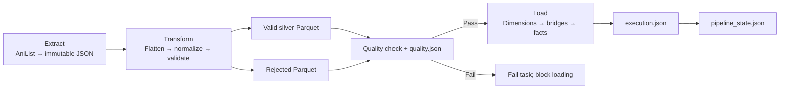

# Anime Data Platform

A learning and portfolio project that collects anime metadata and episode schedules
from AniList, validates the data, and loads a PostgreSQL star schema.

The core ETL workflow is implemented. Live API/database acceptance checks are
required before claiming a verified end-to-end deployment.

Pending hardening: correct the project database URL, verify the running schema,
reject incomplete legacy payloads, add an explicit daily refresh option, and add
the automated test suite. The refresh and test instructions below apply after
those code changes are added.

## Workflow



Airflow runs two independent DAGs:

| DAG | Schedule | Input |
|---|---|---|
| `anime_backfill_dag` | Manual | `year` and `season` |
| `anime_daily_dag` | 00:05, Asia/Ho_Chi_Minh | Scheduled date or manual `target_date` |

Each DAG has six tasks: `extract_to_raw`, `transform_to_silver`,
`quality_check`, `load_gold`, `execution_report`, and `update_checkpoint`.

## Technology

- Python 3.14 and Apache Airflow 3.4.0, as configured in the Docker image.
- Requests for AniList GraphQL requests.
- Polars and Parquet for silver and rejected data.
- SQLAlchemy and psycopg2 for PostgreSQL upserts.
- PostgreSQL 18: separate Airflow metadata and anime datamart services.
- Pytest is listed in requirements; the automated test suite is pending.

Validation uses custom Python functions. Spark services are included in Compose,
but the current ETL does not run Spark jobs. MAL and personal watchlist ingestion
are deferred.

## Data rules

- Raw JSON is immutable: existing snapshots are never overwritten or deleted.
- Normal runs reuse a cached raw snapshot.
- Planned repair option: manual `force_refresh=true` will save a new daily snapshot
  and preserve older files after the refresh patch is applied.
- Optional null values are allowed. A required-field presence check is pending
  to stop incomplete legacy query results from being loaded as null metadata.
- Unknown scores are allowed. Present scores must be between 0 and 100.
- Partial release dates retain known year/month/day components.
- Invalid and duplicate source records are retained in rejected Parquet.
- Source reconciliation is `input_count = valid_count + rejected_count`.
- Any rejected record fails the quality gate and blocks loading.
- All gold writes share one transaction: dimensions, then bridges, then facts.
- Checkpoints are saved after the successful execution report.

Daily source counts represent airing events. Several events can share one anime
row, so relationship-table counts are not added to source reconciliation.

## Storage and modules

```text
dags/
  anime_backfill_dag.py
  anime_daily_dag.py
src/
  ingestion/
    anilist_fetcher.py
    base_fetcher.py
  extract.py
  flatten.py
  transform.py
  validate.py
  load.py
  quality_report.py
  config.py
  logger.py
sql/
  create_anime_db.sql
tests/
  test_pipeline.py              # proposed; not yet added
data/
  raw/anilist/
  silver/<run_id>/<attempt>/
  rejected/<run_id>/<attempt>/rejected.parquet
  reports/<run_id>/
    quality.json
    execution.json
metadata/
  pipeline_state.json
```

Silver contains `anime.parquet`, `anime_genres.parquet`,
`anime_studios.parquet`, `anime_tags.parquet`, and `airings.parquet`.
A retry writes a new silver/rejected attempt directory.

## Gold schema

| Table | Business key |
|---|---|
| `dim_anime` | AniList ID |
| `dim_genre` | Genre name |
| `dim_studio` | Studio name |
| `dim_tag` | Tag name |
| `dim_season` | Season and year |
| `bridge_anime_genre` | Anime and genre IDs |
| `bridge_anime_studio` | Anime and studio IDs |
| `bridge_anime_tag` | Anime and tag IDs |
| `fact_anime_snapshot` | Anime ID and collection date |
| `fact_anime_airing` | AniList airing ID |

`fact_user_watchlist` is defined in SQL but is not populated by these DAGs.

A snapshot records the score observed when collected. Fetching a 2023 season now
does not reconstruct its 2023 scores. Scores can change after a title finishes.

## Local setup

Requires Docker Engine/Desktop with Docker Compose v2.

1. For a new checkout, copy `.env.example` to `.env`. Preserve an existing `.env`.
2. Configure real datamart credentials, `POSTGRES_DB=anime_db`,
   `POSTGRES_HOST=datamart`, and `POSTGRES_PORT=5432`.
3. Configure `DATABASE_URL` with driver `postgresql+psycopg2`, host
   `datamart`, port 5432, and URL-encoded username/password.
4. Set private Fernet and JWT keys. Keep credentials and generated auth files untracked.
5. Ensure the mounted directories are writable by the Airflow container user.

Airflow's `AIRFLOW__DATABASE__SQL_ALCHEMY_CONN` connects to the separate
`postgres` service. The project's `DATABASE_URL` connects to `datamart`.

```bash
mkdir -p data logs metadata plugins
docker compose config --quiet
docker compose build
docker compose up -d postgres datamart
docker compose up airflow-init
docker compose up -d airflow-webserver airflow-scheduler airflow-processor
```

Open Airflow at http://localhost:8081. Use the credentials generated/configured by
the Simple Auth Manager; the password file is private.

Create these Airflow pools before triggering the DAGs:

| Pool | Slots |
|---|---:|
| `anilist_api` | 1 |
| `anime_gold` | 1 |

The shared pools serialize API extraction and gold/checkpoint writes across both DAGs.

The anime database is available at `datamart:5432` inside Compose, or
`localhost:5433` from the host. Use the appropriate hostname and port for the client.

SQL initialization runs only when the datamart data directory is empty. Updating
`create_anime_db.sql` does not migrate an existing database. Review schema changes
or explicitly rebuild a disposable datamart; preserve Airflow's metadata volume.

## Run and inspect

- Backfill: manually trigger with, for example,
  `{"year": 2023, "season": "SPRING"}`.
- Daily: manually trigger with `{"target_date": "2026-11-10"}`, or unpause
  for scheduled runs.
- After adding the refresh patch, repair an incompatible daily cache with the target date and
  `"force_refresh": true`. Return to `false` for normal reuse and repeat tests.

Inspect `quality.json`, `execution.json`, rejected Parquet, and
`metadata/pipeline_state.json`. Quality failures save a failed quality report.
Load failures prevent the successful execution report and checkpoint.

Database affected-row counts are separate from source counts. They do not report
an inserted/updated split; `null` means the driver did not provide a count.

## Tests

The test suite is not yet added. After adding `tests/test_pipeline.py` and
rebuilding the image to install pytest, mount the tests into a temporary Airflow container:

```bash
docker compose run --rm --no-deps -T \
  --volume "$PWD/tests:/opt/airflow/tests:ro" \
  --entrypoint python airflow-processor \
  -B -m pytest -q -p no:cacheprovider /opt/airflow/tests
```

The proposed tests use temporary files and mocked network/database calls. They cover missing
fields versus nulls, invalid scores, partial dates, rejected rows, empty days,
immutable raw files, cache refresh, and load-error propagation.

Live acceptance checks are separate:

1. Verify the running gold schema matches the SQL file.
2. Complete one backfill and one daily run, including reports and checkpoints.
3. Replay the same cached snapshot: business-key row counts must not grow.
4. Confirm rejected rows fail quality and block loading.
5. Compare database contents with the corresponding silver files.

## Current limits

- Daily data describes scheduled airings, not independent confirmation of broadcast.
  AniList only aims to guarantee future airing data.
- The current daily query includes full anime metadata.
- Older-title score refresh is manual through seasonal runs; no recurring refresh
  policy is implemented.
- The timestamp guard protects score snapshots. Metadata and airing details follow
  load order, and old bridge links are retained.
- The checkpoint records completed partitions; it does not automatically skip them.
