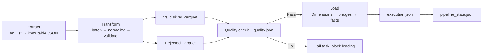
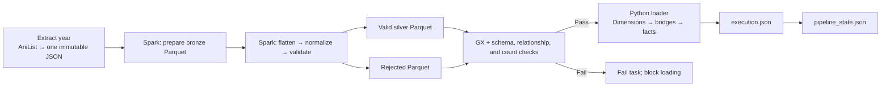

# Anime Data Platform

A learning and portfolio project that collects anime metadata and episode schedules
from AniList, validates the data, and loads a PostgreSQL star schema.

The project has two transformation paths: Polars for daily airings and seasonal
backfills, and Apache Spark for yearly backfills. Both load the same PostgreSQL
gold tables through the existing transactional Python loader.

The yearly workflow adds bronze Parquet and a Great Expectations (GX) quality
gate. A recorded 2022 backfill contains 918 valid anime, zero rejected records,
a passing quality report, a reported committed load, and a matching checkpoint.

## Workflow

### Daily and seasonal ETL with Polars



### Yearly ETL with Spark and Great Expectations



Airflow runs three ETL DAGs:

| DAG | Schedule | Input |
|---|---|---|
| `anime_backfill_dag` | Manual | `year` and `season` |
| `anime_daily_dag` | 00:05, Asia/Ho_Chi_Minh | Scheduled date or manual `target_date` |
| `anime_yearly_backfill_dag` | Manual | Release `year` |

The Polars DAGs have six tasks: `extract_to_raw`, `transform_to_silver`,
`quality_check`, `load_gold`, `execution_report`, and `update_checkpoint`.

The yearly DAG is defined in `dags/anime_yearly_spark_dag.py` and has seven tasks:
`extract_to_raw`, `prepare_bronze`, `transform_to_silver`, `check_quality`,
`load_gold`, `execution_report`, and `update_checkpoint`.

The three Spark stages use `SparkSubmitOperator` with the `spark_local` connection
and master `local[2]`. They run inside the Airflow task container using two local
threads. The separate Spark master/worker services in Compose are available for
cluster exercises; the yearly DAG does not currently submit jobs to them.

## Technology

- Python 3.14 and Apache Airflow 3.4.0, as configured in the Docker image.
- Requests for AniList GraphQL requests.
- Polars 1.8.2 for daily/seasonal transformation and reading silver for loading.
- Apache Spark / PySpark 4.1.0 for yearly bronze and silver processing.
- Great Expectations 1.24.1 for yearly dataset validation.
- Parquet for bronze, silver, and rejected datasets.
- SQLAlchemy and psycopg2 for PostgreSQL upserts.
- PostgreSQL 18: separate Airflow metadata and anime datamart services.
- Pytest for the focused tests in `test/test_pipeline.py`.

Spark reuses the existing Python normalization and row-validation functions
through UDFs: Python functions applied to Spark rows. Spark then splits the
validated rows into typed silver tables. GX checks the saved datasets before the
loader runs. Gold loading remains Python, SQLAlchemy, and psycopg2.

Both `pyspark` and `pyspark-client` are pinned to 4.1.0. The Airflow Spark provider
installs the client package as a dependency; keeping the versions aligned avoids
incompatible shared PySpark files.

MAL and personal watchlist ingestion are deferred.

## Data rules

- Raw JSON is immutable: existing snapshots are never overwritten or deleted.
- Daily runs reuse the latest cached snapshot for the target date. Seasonal and
  yearly fetches reuse the requested partition's snapshot from the collection day.
- Manual daily `force_refresh=true` saves a new snapshot and preserves older files.
- Optional null values are allowed. Missing requested media fields are rejected
  rather than silently converted to null metadata.
- Unknown scores are allowed. Present scores must be between 0 and 100.
- Partial release dates retain known year/month/day components.
- Invalid and duplicate source records are retained in rejected Parquet.
- Source reconciliation is `input_count = valid_count + rejected_count`.
- Any rejected record fails the quality gate and blocks loading.
- All gold writes share one transaction: dimensions, then bridges, then facts.
- Checkpoints are saved after the successful execution report.

Daily source counts represent airing events. Several events can share one anime
row, so relationship-table counts are not added to source reconciliation.

Seasonal and yearly source counts represent anime records. Yearly extraction
filters AniList `startDate_like` by the requested year and follows pagination.
It collects titles first released in that calendar year, not every older title
that aired an episode during the year. Titles without a known matching start year
are outside this selection. The fetcher fails if more results remain at its
5,000-entry pagination limit instead of saving a supposedly complete year.

Yearly title extraction does not request episode schedules, so its `airings`
silver dataset is empty and it does not populate new airing events.

## Storage and modules

```text
dags/
  anime_backfill_dag.py
  anime_daily_dag.py
  anime_yearly_spark_dag.py      # DAG ID: anime_yearly_backfill_dag
src/
  ingestion/
    anilist_fetcher.py
    base_fetcher.py
  spark_etl_transformation/
    spark_etl.py               # Bronze, silver, and stage entry point
    quality.py                 # GX and saved-dataset quality gate
  extract.py
  flatten.py
  transform.py
  validate.py
  load.py
  quality_report.py
  config.py
  logger.py
  spark_genre_summary.py        # Separate manual analytics exercise
sql/
  create_anime_db.sql
test/
  test_pipeline.py
data/
  raw/anilist/
  silver/<run_id>/<attempt>/
  rejected/<run_id>/<attempt>/rejected.parquet
  reports/<run_id>/
    quality.json
    execution.json
metadata/
  pipeline_state.json
```

Polars silver contains `anime.parquet`, `anime_genres.parquet`,
`anime_studios.parquet`, `anime_tags.parquet`, and `airings.parquet`.
A retry writes a new silver/rejected attempt directory.

Yearly Spark outputs use a separate layout:

```text
data/
  raw/yearly/2022/20261112_125821.json
  bronze/yearly/2022/<run_id>/<attempt>/anime/
  silver/yearly/2022/<run_id>/<attempt>/
    anime/
    anime_genres/
    anime_studios/
    anime_tags/
    airings/
  rejected/yearly/2022/<run_id>/<attempt>/records/
  reports/yearly/2022/<run_id>/<attempt>/
    bronze_manifest.json
    silver_manifest.json
    quality.json
    execution.json
```

`2022` is the requested release year; the raw filename is the collection timestamp
in Vietnam time. Daily raw filenames such as `20261112_01.json` instead identify
the target airing date and snapshot revision; `01` is a counter, not an hour.

Spark writes dataset directories containing `part-*.parquet` files. Bronze keeps
each original media record as JSON text alongside its source path, position, and
collection time, preserving bad values for later rejection. The yearly reader
accepts both media-list pages and complete GraphQL-response pages in raw JSON.

Manifests are small JSON files containing the exact dataset paths and counts.
Spark quality checks read the dataset directories; the Polars loader uses the
manifest's Parquet file patterns. Derived Spark outputs may be overwritten within
the same isolated execution when a task retries. Raw JSON remains immutable.

The `main()` entry point in `spark_etl.py` reads `--layer` and `--source`, creates
the Spark session, runs one stage, and stops Spark in `finally`. Its
`if __name__ == "__main__"` guard starts the job during script execution while
allowing other tasks to import path helpers without starting Spark.

Data outputs, reports, logs, and generated authentication files are ignored by Git.

## Gold schema

| Table | Business key |
|---|---|
| `dim_anime` | AniList ID |
| `dim_genre` | Genre name |
| `dim_studio` | Studio name |
| `dim_tag` | Tag name |
| `dim_season` | Season and year |
| `bridge_anime_genre` | Anime and genre IDs |
| `bridge_anime_studio` | Anime and studio IDs |
| `bridge_anime_tag` | Anime and tag IDs |
| `fact_anime_snapshot` | Anime ID and collection date |
| `fact_anime_airing` | AniList airing ID |

`fact_user_watchlist` is defined in SQL but is not populated by these DAGs.

A snapshot records the score observed when collected. Fetching a 2023 season or year now
does not reconstruct its 2023 scores. Scores can change after a title finishes.

Gold tables are the source for database analytics. For current rankings, select
one latest available snapshot per anime before aggregating. Historical charts
retain collection dates. The separate `spark_genre_summary.py` exercise currently
reads one Polars silver attempt to calculate genre/season summaries and top-five
rankings; its analytics DAG is still a placeholder.

## Local setup

Requires Docker Engine/Desktop with Docker Compose v2.

1. For a new checkout, copy `.env.example` to `.env`. Preserve an existing `.env`.
   The current template does not include all Airflow metadata database variables;
   add the settings listed below.
2. Configure private datamart credentials and `POSTGRES_DB=anime_db`.
3. Configure `DATABASE_URL` with driver `postgresql+psycopg2`, host
   `datamart`, port 5432, and URL-encoded username/password. Configure the separate
   Airflow metadata database URL and credentials as well.
4. Set private Fernet and JWT keys. Keep credentials and generated auth files untracked.
5. Ensure the mounted directories are writable by the Airflow container user.

| Environment variables | Purpose |
|---|---|
| `POSTGRES_USER`, `POSTGRES_PASSWORD`, `POSTGRES_DB` | Datamart database initialization |
| `DATABASE_URL` | Project loader URL: `postgresql+psycopg2`, host `datamart`, port 5432 |
| `AIRFLOW_DB_USER`, `AIRFLOW_DB_PASSWORD`, `AIRFLOW_DB` | Airflow metadata database initialization |
| `AIRFLOW_DATABASE_URL` | Metadata URL: `postgresql+psycopg2`, host `postgres`, port 5432 |
| `AIRFLOW_FERNET_KEY`, `AIRFLOW_JWT_SECRET` | Private Airflow encryption/signing keys |

Compose passes `AIRFLOW_DATABASE_URL` to
`AIRFLOW__DATABASE__SQL_ALCHEMY_CONN`. The project's `DATABASE_URL` connects to
`datamart`. Each URL must contain credentials matching its database's settings.
URL encoding changes how special characters are represented; it does not change
the actual password. Keep ordinary passwords in the corresponding password variables.

```bash
mkdir -p data logs metadata plugins
docker compose config --quiet
docker compose build
docker compose up -d postgres datamart
docker compose up airflow-init
docker compose up -d airflow-webserver airflow-scheduler airflow-processor
```

Open Airflow at http://localhost:8081. Use the credentials generated/configured by
the Simple Auth Manager; the password file is private.

Create these Airflow pools before triggering the DAGs:

| Pool | Slots |
|---|---:|
| `anilist_api` | 1 |
| `anime_gold` | 1 |

The shared pools serialize API extraction and gold/checkpoint writes across all
three DAGs.

Create the yearly DAG's Spark connection once:

```bash
docker compose exec airflow-scheduler \
  airflow connections add spark_local \
  --conn-type spark \
  --conn-host 'local[2]'
```

If the connection already exists, inspect/edit it in Airflow. Verify the Airflow
container's runtime before submitting Spark jobs:

```bash
docker compose exec airflow-scheduler java -version
docker compose exec airflow-scheduler \
  python -B -c 'from importlib.metadata import version; import pyspark; print(pyspark.__version__, version("pyspark-client"), version("great-expectations"))'
```

Spark needs Java 17 or later. Expected Python package versions are
`4.1.0 4.1.0 1.24.1`. The Dockerfile installs the Java runtime. After changing
requirements, rebuild and recreate the Airflow services so they use the new image.

Optional standalone Spark services can be started with
`docker compose up -d spark-master spark-worker`; their master UI is at
http://localhost:8082. This does not change the yearly DAG's `local[2]` execution.

The anime database is available at `datamart:5432` inside Compose, or
`localhost:5433` from the host. Use the appropriate hostname and port for the client.

SQL initialization runs only when the datamart data directory is empty. Updating
`create_anime_db.sql` does not migrate an existing database. Review schema changes
or explicitly rebuild a disposable datamart; preserve Airflow's metadata volume.

## Run and inspect

- Seasonal backfill: manually trigger `anime_backfill_dag` with, for example,
  `{"year": 2023, "season": "SPRING"}`.
- Yearly Spark backfill: manually trigger `anime_yearly_backfill_dag` with
  `{"year": 2022}`. One completed raw JSON contains the year's fetched pages.
- Daily: manually trigger `anime_daily_dag` with `{"target_date": "2026-11-12"}`, or unpause
  for scheduled runs.
- To collect a fresh daily snapshot, supply the target date and
  `"force_refresh": true`. Return to `false` for normal cache reuse.

Triggering an ETL DAG makes API calls when no matching cache exists and loads
PostgreSQL after validation succeeds. Inspect the task logs, manifests,
`quality.json`, `execution.json`, rejected Parquet, and
`metadata/pipeline_state.json`. Quality failures save a failed quality report.
Load failures prevent the successful execution report and checkpoint.

For a failed yearly task, fix the cause and clear that task with downstream tasks
selected. Keep successful upstream tasks completed so the same raw snapshot and
execution paths are reused. The checkpoint uses seasonal keys such as
`2023_spring`, yearly keys such as `2022`, and daily target dates under `airings`.

Database affected-row counts are separate from source counts. They do not report
an inserted/updated split; `null` means the driver did not provide a count.

## Tests

The focused test suite is in `test/test_pipeline.py` (singular `test/`). After
building the image with pytest, mount it into a temporary Airflow container:

```bash
docker compose run --rm --no-deps -T \
  --volume "$PWD/test:/opt/airflow/tests:ro" \
  --entrypoint python airflow-processor \
  -B -m pytest -q -p no:cacheprovider /opt/airflow/tests
```

The tests use temporary files and mocked network/database calls. They cover missing
fields versus nulls, invalid scores, partial dates, rejected rows, empty days,
immutable raw files, cache refresh, and load-error propagation.

These tests primarily exercise the existing Python/Polars pipeline. They do not
provide an end-to-end Spark/GX or live PostgreSQL test.

### Recorded yearly run

Local reports dated 2026-11-12 record a 2022 yearly run with:

- 918 input records, 918 valid anime, and zero rejected records.
- A passing GX quality report covering the five silver tables, including the
  expected empty airings dataset.
- Loader status `loaded` and `database_committed=true`.
- A successful execution report and matching `seasonal/2022` checkpoint.

These are application-level reports; they are ignored by Git and are not bundled
with a fresh checkout. Database-level verification is a separate acceptance step.

For a new setup or changes to the pipeline:

1. Verify the running gold schema matches the SQL file.
2. Complete one seasonal, yearly Spark, and daily run, including reports and checkpoints.
3. Replay the same cached snapshot: business-key row counts must not grow.
4. Confirm rejected rows fail quality and block loading.
5. Compare database contents with the corresponding silver files.

## Yearly quality checks

Python row validators check required query fields, IDs, scores, enums, date
components, and nested relationship values. Invalid source records and later
duplicate anime IDs are retained in rejected Parquet with their original JSON,
source position, and reasons.

The quality task then reads the saved Parquet and checks:

- Expected column names/types and agreement with manifest counts.
- Source reconciliation against the saved bronze records.
- Requested release year, source collection time, and Vietnam snapshot date.
- Relationship rows referencing an existing silver anime ID.
- GX expectations for non-null/unique keys, positive IDs, bounded scores,
  nonnegative counts, and tag ranks.
- Zero rejected records before loading.

Empty tables are allowed when appropriate; their schemas and reconciliation still
apply. GX results and the final pass/fail status are saved in `quality.json`.

## Current limits

- Daily data describes scheduled airings, not independent confirmation of broadcast.
  AniList only aims to guarantee future airing data.
- The current daily query includes full anime metadata.
- Older-title score refresh is manual through seasonal runs; no recurring refresh
  policy is implemented.
- The timestamp guard protects score snapshots. Metadata and airing details follow
  load order, and old bridge links are retained.
- The checkpoint records completed partitions; it does not automatically skip them.
- Yearly Spark currently runs locally, uses Python UDFs, and parses the single raw
  JSON document before distributing its rows. Distributed-cluster performance has
  not been benchmarked.
- The Python loader reads silver rows into memory before upserting them. It is
  suitable for this project's batches, not a demonstrated large-scale database sink.
